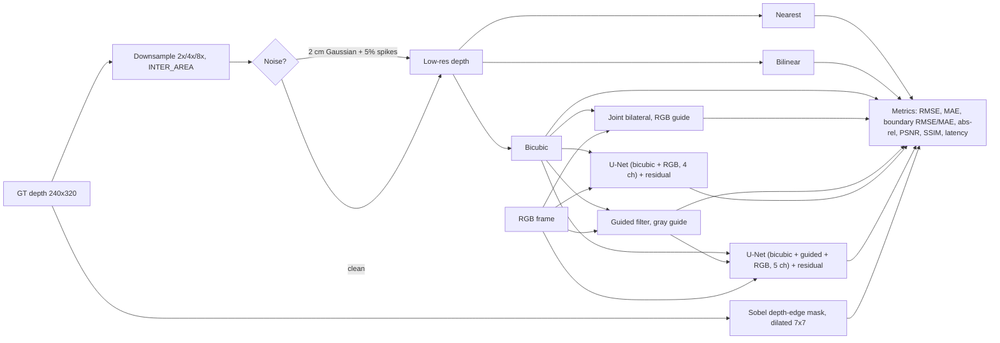

# PS4 Design Document: Edge-Preserving Depth Map Upsampling

Live demo: https://depth-upsampling-ncflvqguerfmecgrmz5xmd.streamlit.app/

## Architecture

## Methods (`ps4.py`)
- **Interpolation baselines:** nearest, bilinear, bicubic via `cv2.resize`.
- **Joint bilateral:** `cv2.ximgproc.jointBilateralFilter` on the bicubic result, with the RGB frame as guide.
- **Guided filter:** custom single-channel implementation (box filters, eps = 1e-3), grayscale guide, radius = max(4, factor), applied to the bicubic result.
- **CNN-only:** small U-Net (3 down/up levels, 24 base channels), input = bicubic depth + RGB. It predicts a residual added to the bicubic depth, clamped to [0, 10 m].
- **Hybrid:** same U-Net with 5 input channels (bicubic, guided-filtered depth, RGB). It predicts a residual added to the guided depth.

## Training
- NYU Depth V2: 500 evenly sampled frames at 240x320; contiguous split 350/50/100. No pretrained weights.
- Each step draws a random factor from {2, 4, 8} and applies a random horizontal flip.
- Loss: masked L1 on valid pixels + 2x masked gradient L1 (boundary-aware).
- AdamW, lr 2e-3 with cosine decay, batch 16, 8-minute budget per model on CPU (27 and 46 steps).

## Boundary handling
- Evaluation: boundary band = dilated Sobel mask of GT depth discontinuities. Boundary RMSE/MAE are computed inside it.
- Training: the gradient loss penalises smoothed edges. RGB guidance enters through the guided filter, the joint bilateral filter and the network input.

## Requirements coverage (self-audit)
| Requirement | Status |
|---|---|
| Nearest / bilinear / bicubic | Implemented |
| Joint bilateral, guided filter | Implemented |
| CNN upsampling, RGB guidance, hybrid | Implemented |
| 2x / 4x / 8x | Implemented |
| RMSE, MAE, boundary accuracy | Implemented |
| Edge detection, boundary-aware refinement, discontinuity detection | Partial (Sobel mask; gradient loss; no confidence gate) |
| Noise removal | Partial (guided filter; synthetic noise evaluation) |
| Hole filling, missing-depth handling | Missing / insufficient |
| Texture-copying prevention | Partial (no dedicated mechanism) |
| Unseen depth maps | Partial (internal test split only) |
| Unseen dataset (Middlebury/KITTI) | Missing |
| PSNR/SSIM | Partial (SSIM includes invalid pixels) |
| Latency / memory | Partial (per-method latency; GPU memory only) |

## Limitations and future work
Undertrained models (CPU, 27 and 46 steps), clean-only training, an untuned guided filter, no unseen-dataset test, no hole filling. Planned: GPU retraining, filter tuning on the val split, a depth-discontinuity confidence gate to suppress texture copying, and a median-filter noise baseline.
